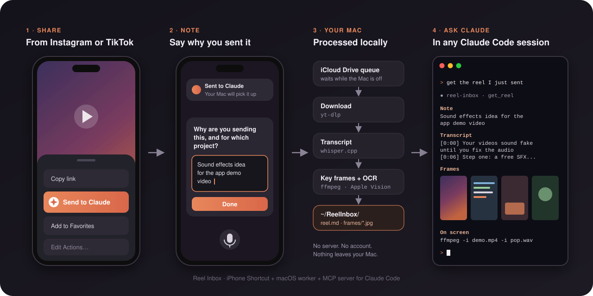
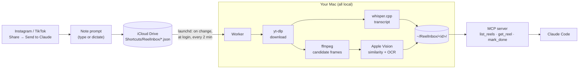

<h1 align="center">Reel Inbox</h1>

<p align="center">
  <b>Share a Reel from your iPhone with a note. Ask Claude Code about it later.</b><br>
  Claude gets your note, the full transcript, the key frames as images, and any code that was on screen.
</p>

<p align="center">
  
</p>

<p align="center">
  
  
  
  
  
</p>

---

A lot of good Claude Code tips, tools and build ideas show up as 40-second Reels. Watching one on
your phone and then trying to explain it to Claude later loses most of it: the repo name that was on
screen for a second, the exact command, what the person actually said.

Reel Inbox closes that gap with three small pieces:

1. **An iPhone Shortcut** in the share sheet. Share a Reel (or TikTok), say or type why you're
   sending it, done. It saves the link and your note to iCloud Drive, so it works with your Mac
   off.
2. **A macOS worker** that downloads each video, transcribes it, picks the frames that matter, and
   reads the on-screen text with Apple's Vision framework. Everything runs on your Mac and costs
   nothing.
3. **An MCP server for Claude Code**, so any session can answer "get the reel I just sent", and Claude
   actually sees the frames.

## What Claude gets

```
~/ReelInbox/2026-11-07-170623-a-terminal-trick-to-try/
├── reel.md       ← your note, link, creator, caption, timestamped transcript, on-screen text per frame
├── meta.json     ← the same, structured (status, errors, frame times, opened/done)
├── source.json   ← exactly what the phone sent
└── frames/       ← up to 12 key frames, e.g. 03_0m07s.jpg
```

In Claude Code:

| You say | What happens |
|---|---|
| "get the reel I just sent" | `get_reel` returns the newest one: text plus the frames as images |
| "go through my reels" | `get_reel id:"next"` walks unread reels oldest first, one at a time |
| "what reels do I have?" | `list_reels` shows each one with your note, and how many are unread |
| "the one about sound effects" | `get_reel` matches words from your note, the caption or the creator |
| "mark it done" | `mark_done` hides it from the list (nothing is deleted) |

New sessions are told how many unread reels are waiting, so Claude can mention them without being
asked.

## How it works



On an M3 Pro a typical 50-second Reel takes 10–15 seconds from start to finish. A stack sent while the
Mac was asleep is worked through oldest first, one at a time, the next time it's awake.

## Requirements

- A Mac with Apple silicon. Tested on an M3 Pro with macOS 26. Intel Macs are untested.
- [Homebrew](https://brew.sh), Xcode Command Line Tools (`xcode-select --install`), and
  [Claude Code](https://docs.anthropic.com/en/docs/claude-code)
- An iPhone with the Shortcuts app, signed in to **the same Apple ID** as the Mac, with iCloud Drive on
- About 600 MB of disk, almost all of it the speech model

The installer adds the rest with Homebrew, all free and open source: `yt-dlp`, `ffmpeg`, `whisper.cpp`,
and Python if you don't have Homebrew's already.

## Setup

**1. Have the basics.** Homebrew, the Xcode Command Line Tools, and Claude Code (see Requirements).
If `brew`, `swiftc` and `claude` all run in Terminal, you're set.

**2. Clone the repo** somewhere it can stay. The background job and Claude both point at this folder.
If you move it later, run `./install.sh` again.

```bash
git clone https://github.com/silasapostol13-web/claude-reel-inbox.git ~/reel-inbox
```

**3. Run the installer.** It installs `yt-dlp`, `ffmpeg` and `whisper-cpp` with Homebrew if they're
missing, downloads the speech model (about 575 MB, once), compiles two small Swift helpers, starts the
background job, registers the MCP server for every Claude Code session, and adds a small Claude skill.
It's safe to run again.

```bash
cd ~/reel-inbox && ./install.sh
```

**4. Put the Shortcut on your iPhone.** On the phone, open
[this link](https://github.com/silasapostol13-web/claude-reel-inbox/raw/main/shortcut/Send%20to%20Claude.shortcut)
in Safari, then tap **Add Shortcut**. (Or AirDrop `shortcut/Send to Claude.shortcut` from the Mac.)
The file is signed so anyone can import it. To build your own from source instead, run
`python3 shortcut/build_shortcut.py`.

**5. Pin it in the share sheet.** In Instagram, tap the paper plane, then **Share to…**, scroll to the
bottom, tap **Edit Actions…**, and add **Send to Claude** to Favorites.

**6. Try it.** Share a Reel, say a note, tap **Done**. A minute or two later:

```bash
ls ~/ReelInbox
```

Then open Claude Code anywhere and say *"get the reel I just sent"*.

**Test it without the phone:**

```bash
python3 ~/reel-inbox/worker/reel_worker.py --url "https://www.instagram.com/reel/…" --note "test"
```

> **No share button handy?** Copy the Reel's link and run **Send to Claude** on its own (home screen,
> Action Button, Back Tap). With nothing shared, it uses the link on your clipboard.

## Design decisions

**iCloud Drive is the queue.** No server, no account, no open port, nothing to host. The phone never
needs the Mac: shares wait in iCloud while it's off and get processed when it wakes. The cost is that
timing depends on iCloud sync, which is usually seconds.

**The note comes first.** The Shortcut asks for your note before it does anything else, and always
saves a file. An early version checked for the link first and, on a real share, quietly skipped the
note. Now an odd share still arrives, and the Mac explains what went wrong.

**Transcription is local.** whisper.cpp with `large-v3-turbo` (q5) runs on the GPU through Metal. The
post caption and creator name go in as a prompt, so names and product terms come out spelled right.
No API key, no per-minute cost.

**Frames are picked for what's readable, not just for scene cuts.** Candidates are ffmpeg scene changes
plus a steady sample every ~1.5 s, so slow screen recordings aren't missed. Blank and fade frames are
dropped. The timeline is split into windows, and in each one the frame with the most readable text
wins, so a terminal or a GitHub page beats a talking head. Frames that look alike, measured by
Vision's image feature prints, are merged and the wordier one is kept. The cap is 12.

**OCR is tuned for code.** Apple Vision text recognition runs with language correction off, because
correction "fixes" code into English. Lines that just repeat the speech (burned-in subtitles) and lines
already shown on an earlier frame are dropped from `reel.md`. Claude still gets every frame as an
image, so nothing is really lost.

**The MCP server has no dependencies.** It's about 300 lines of standard-library Python speaking
JSON-RPC over stdio, so there's nothing to pin or update. Frames go back as MCP image content, which
means Claude looks at them instead of guessing from the text. The unread count reaches new sessions
through the server's own instructions, with no hooks or settings changes.

**Nothing fails silently.** A failed reel gets a folder with a plain-English reason ("Instagram
won't show this post without logging in…"). It's retried after 5, 10 and 15 minutes, and if the
Mac is offline right after waking it waits instead of using up retries. After 4 tries it moves to
`failed/` with the error inside.

**Phone files are fetched from iCloud properly.** A file saved on the iPhone first shows up on the Mac
as a placeholder with no data in it, and a background job that just opens it gets stuck. A tiny Swift
helper (`vision/icloudread.swift`) asks iCloud to download it first. This was found the hard way, on
the first real share.

## Privacy

- Video, audio, transcripts, frames and OCR all stay on your Mac. Nothing is sent to any server run by
  this project, because there isn't one.
- The only network traffic is `yt-dlp` fetching the video from Instagram/TikTok, iCloud syncing the
  small note file, and the one-time model download from Hugging Face.
- Your notes live in your own iCloud Drive (`Shortcuts/ReelInbox/`) and in `~/ReelInbox/`.
- Claude Code sees a reel only when you (or a session) call the tool.

## Limits and honest caveats

- **Personal use only.** Downloading videos from Instagram or TikTok goes against their terms of
  service. This is a tool for taking notes on content you're already watching, not for re-posting
  anything. Respect creators' work.
- **Downloads can break.** Instagram and TikTok change things often, and `yt-dlp` keeps up, but there
  can be gaps. Keep it current with `brew upgrade yt-dlp`. Public Reels download without a login
  today. Private posts, and anything that needs a login, fail with a clear message. The worker never
  uses your browser cookies.
- **Photo posts and carousels** work too, through the same `yt-dlp` (no extra tool). Every photo slide
  becomes a frame with its text read off it, video slides inside a carousel are transcribed like a
  short video, and the post caption is kept. Up to 20 slides per post.
- **OCR is imperfect** on stylized captions, tiny terminal text and motion blur. That's why the
  frames themselves are always passed along.
- **Mac only**, because the worker uses Apple's Vision framework and launchd. The phone side needs
  iOS Shortcuts.

## Troubleshooting

| Symptom | Where to look |
|---|---|
| Nothing shows up | `ls ~/Library/Mobile\ Documents/iCloud~is~workflow~my~workflows/Documents/ReelInbox/`: is the file there? |
| A reel failed | `~/ReelInbox/<id>/reel.md` has the reason; the phone's original file moves to `ReelInbox/failed/` in iCloud |
| Worker log | `~/Library/Application Support/ReelInbox/worker.log` |
| Settings | `~/Library/Application Support/ReelInbox/config.json`, written by `./install.sh`. To keep reels somewhere else, run `REEL_INBOX_OUT=~/Documents/Reels ./install.sh` |
| Run it by hand | `python3 ~/reel-inbox/worker/reel_worker.py --url "https://www.instagram.com/reel/…" --note "test"` |
| Claude doesn't see the tools | `claude mcp list` should show `reel-inbox ✔ Connected`; re-run `./install.sh` |

**Uninstall:** `./uninstall.sh` stops the background job, removes the MCP server, and moves the model
and helpers to the Trash. Your reels and the skill are kept unless you add `--all`. Add `--dry-run` to
see what it would do first.

## Repo layout

| Path | What |
|---|---|
| `shortcut/build_shortcut.py` | Builds and signs `shortcut/Send to Claude.shortcut` from code |
| `worker/reel_worker.py` | The worker (standard-library Python). `--url` processes one link by hand |
| `vision/reelvision.swift` | On-device OCR and image similarity with Apple Vision |
| `vision/icloudread.swift` | Reads iCloud placeholders safely through `NSFileCoordinator` |
| `mcp/reel_mcp.py` | The MCP server (stdio, no dependencies) |
| `skill/reel-inbox/SKILL.md` | Teaches Claude what "the reel I sent" means |
| `install.sh` | Safe to re-run: tools, model, helpers, launchd job, MCP registration, skill |
| `uninstall.sh` | Undoes `install.sh`, moving files to the Trash (`--all` includes your reels) |

## Related projects

- **[reel-relay](https://github.com/siemd2/reel-relay)** does something similar as a self-hosted
  server: share by Telegram bot, iOS Shortcut or Instagram DM, transcribe with Groq's hosted Whisper,
  and reach it over a tunnel. Its `get_reel` tool shape was a useful reference. Reel Inbox makes the
  opposite trade-off: no server, no tunnel, no API key, everything on your own Mac.
- **[media-mcp](https://github.com/woosal1337/media-mcp)** is a general MCP server for frames and local
  Whisper transcripts from media files and URLs.
- Built on **[yt-dlp](https://github.com/yt-dlp/yt-dlp)**, **[whisper.cpp](https://github.com/ggml-org/whisper.cpp)**,
  **[FFmpeg](https://ffmpeg.org)**, and Apple's Vision framework.

## License

[MIT](LICENSE)
